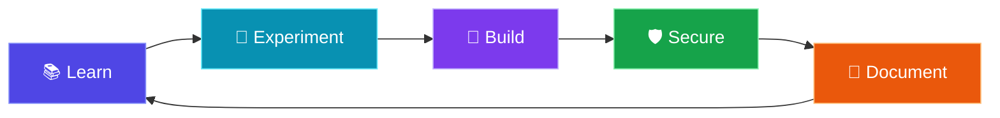

<div align="center">

<!-- Animated profile banner -->


<p>
  
</p>

<p>
  
  
  
</p>

</div>

---

## `01` — About Me

```bash
$ whoami
Dhanush

$ role
College Student | Cybersecurity Enthusiast

$ mission
Learn the principles of security and build practical skills.
```

I'm a college student building my knowledge in **cybersecurity**. I'm interested in how systems work, how vulnerabilities are discovered, and how digital environments can be made safer. This profile documents my learning journey, experiments, and projects.

## `02` — Current Focus

<table>
  <tr>
    <td width="50%">
      <h3>🔍 Security Fundamentals</h3>
      Building a strong foundation in cybersecurity concepts, networks, and system security.
    </td>
    <td width="50%">
      <h3>🛡️ Defensive Security</h3>
      Learning about threat awareness, secure configurations, and ways to reduce risk.
    </td>
  </tr>
  <tr>
    <td width="50%">
      <h3>🧪 Ethical Security Testing</h3>
      Exploring vulnerability concepts and responsible testing in authorized environments.
    </td>
    <td width="50%">
      <h3>⚙️ Hands-on Learning</h3>
      Practising through coursework, labs, and projects while documenting what I learn.
    </td>
  </tr>
</table>

## `03` — My Learning Workflow

<div align="center">



</div>

## `04` — Goals

- [ ] Strengthen cybersecurity and networking fundamentals.
- [ ] Practise in legal, controlled lab environments.
- [ ] Build and document practical projects.
- [ ] Improve scripting and problem-solving skills.
- [ ] Keep learning about defensive techniques and responsible disclosure.

## `05` — Principles

<div align="center">

| 🔐 Responsibility | 🧠 Curiosity | 🚀 Consistency |
|:---:|:---:|:---:|
| Test only with permission. | Ask how systems work. | Learn and improve every day. |

</div>

---

<div align="center">

### `root@dhanush:~$`

**Learning today. Building securely for tomorrow.**

<sub>“The quieter you become, the more you are able to hear.”</sub>


</div>
